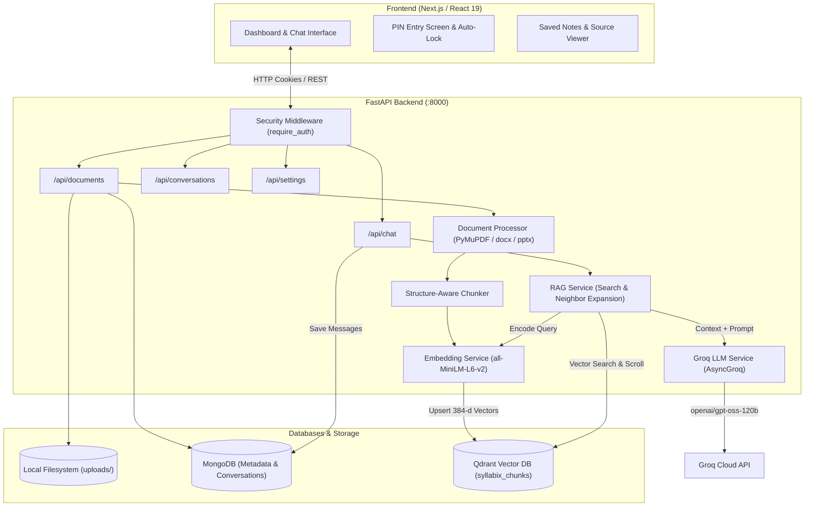
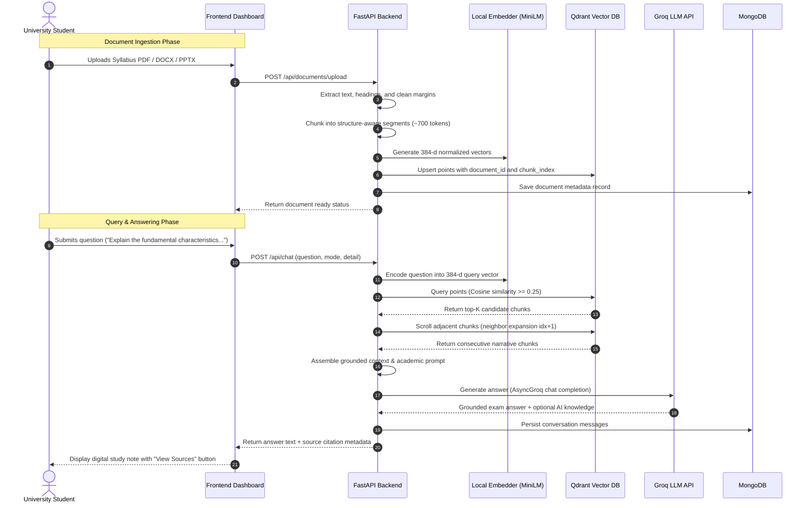

# Syllabix

> **"Your syllabus. Your AI. Your answers."**

Syllabix is a personal, AI-powered academic study assistant designed for university students. It transforms your raw lecture notes, textbooks, and syllabus materials into exam-ready explanations, structured revision notes, and grounded answers—backed by on-demand citations directly from your uploaded documents.

---

## Table of Contents

- [Overview](#overview)
- [Key Features](#key-features)
- [Technology Stack](#technology-stack)
- [System Architecture](#system-architecture)
- [RAG Workflow](#rag-workflow)
- [Answer Modes](#answer-modes)
- [Project Folder Structure](#project-folder-structure)
- [Installation and Setup](#installation-and-setup)
- [Environment Variables](#environment-variables)
- [API Documentation](#api-documentation)
- [Database and Storage](#database-and-storage)
- [Security Architecture](#security-architecture)
- [Screenshots](#screenshots)
- [Known Limitations](#known-limitations)
- [Future Scope](#future-scope)
- [Contribution & License](#contribution--license)

---

## Overview

### The Problem
General-purpose AI chatbots (e.g., standard ChatGPT or Gemini web interfaces) often fall short for university examination preparation:
- **Hallucinations & Generic Answers**: They invent terminology, definitions, or classifications that do not align with a student's specific university syllabus.
- **Unstructured Answers**: Semester examinations award marks for specific structure (definitions, bullet points, comparison tables, and marking-scheme headings) rather than conversational prose.
- **Missing Source Traceability**: Generic chatbots cannot prove which slide or textbook page an answer came from.
- **Privacy & Clutter**: Commercial chatbots are public, multi-tenant services with complex accounts and tracking.

### The Syllabix Solution
Syllabix is a private, single-user study assistant operating on a Retrieval-Augmented Generation (RAG) architecture:
1. Students upload their own syllabus documents (`.pdf`, `.docx`, `.pptx`).
2. Documents are parsed, chunked with section awareness, and embedded locally into dense vectors.
3. When questions are asked, Syllabix searches the student's indexed material using **Qdrant**, retrieves the most relevant excerpts, and expands neighboring context.
4. An academic tutor system prompt powered by **Groq** (`openai/gpt-oss-120b`) generates exam-ready answers.
5. All references remain accessible **on-demand** via an unobtrusive citation drawer.
6. The entire workspace is protected by a personal numeric PIN with automatic inactivity locking.

---

## Key Features

### 1. Personal PIN-Based Security
- **Entry Screen**: Full-page welcome screen featuring ambient lighting, starry background artwork, and an interactive numeric keypad.
- **Constant-Time Verification**: Uses `secrets.compare_digest` to prevent timing attacks.
- **Session Protection**: Issues cryptographically signed (HMAC-SHA256) HTTP-only `SameSite=Lax` cookies. Never stores PINs or tokens in browser `localStorage`.
- **Brute-Force Lockout**: Automatically locks out access for 60 seconds after 5 consecutive incorrect PIN attempts (HTTP 429).
- **Auto-Lock on Inactivity**: Monitors mouse movement, keyboard, touch, scroll, and tab visibility; locks automatically after 5 minutes of inactivity and purges sensitive workspace data from the DOM.
- **Manual Lock**: Immediate one-click lock button in the header, sidebar, and Settings modal.

### 2. Multi-Format Academic Ingestion
- Supports **PDF** (via `PyMuPDF` with running header/footer suppression and font-size heading detection).
- Supports **DOCX** (via `python-docx` with heading styles and table-to-Markdown conversion).
- Supports **PPTX** (via `python-pptx` with slide titles and per-slide text shapes).
- Stores original documents locally in `backend/uploads/` (up to 25 MB per file).
- Tracks upload and extraction progress with animated indicators.

### 3. Structure-Aware Chunking & Local Embeddings
- Consolidates content sharing the same section heading up to the configured token budget (default: 700 tokens, 120 token overlap).
- Preserves sentence, bullet, and numbered-list boundaries.
- Generates 384-dimensional dense embeddings locally using `sentence-transformers/all-MiniLM-L6-v2` via HuggingFace `AutoModel` with PyTorch.

### 4. Semantic Search with Neighboring Context Expansion
- Indexes vectors in Qdrant with Cosine distance.
- Uses a similarity threshold (default: `0.25`) to eliminate irrelevant noise.
- **Neighboring Chunk Expansion**: When a top chunk matches with high confidence ($\ge 0.35$), Qdrant scrolls and includes the immediate consecutive chunk (`chunk_index + 1`), preserving continuous explanations.
- Sorts retrieved excerpts sequentially by document order for coherent narrative generation.

### 5. High-Speed Answer Generation (Groq LLM)
- Uses Groq's official Python SDK (`AsyncGroq`) for non-blocking asynchronous execution.
- Configurable model (default: `openai/gpt-oss-120b`, temperature `0.2`, max completion tokens `4096`).
- Automatic retry with exponential backoff and jitter for transient 429/503 errors.
- System prompt acts as an academic tutor: answers are structured according to question type (definitions, 5-mark short notes, 10-mark essays, and Markdown comparison tables).

### 6. On-Demand Source Verification
- Answers remain clean and uninterrupted—no ugly inline hashes or raw quotations.
- A subtle **"View Sources"** button displays a citation modal showing filename, page/slide location, similarity match score, and original text excerpt.

### 7. Saved Study Notes
- Save valuable answers directly to a personal Study Notes collection.
- Stored client-side in browser storage with full source reference metadata preserved.
- Dedicated Study Notes modal for reviewing, copying, searching, or deleting saved notes.

### 8. Custom AI Loading Animations
- Choose from 3 selectable animations in Settings, rendered across the full horizontal track:
  1. **Boy & Girl**: Storybook rainy-day scene with full horizontal walking movement, bobbing, attached umbrella swaying, lampposts, and puddle ripples.
  2. **Penguin Adventure**: An alpine mountain climb where the penguin's feet maintain mathematical contact with the slope at every pixel, featuring waddling gait, footprints, falling snow, and a summit flag.
  3. **The Lone Warrior**: A cinematic 4-phase choreographed battle scene where a hero defends against shadow adversaries from both sides with energy slash arcs, ground slam shockwaves, and floating embers.
- Persistent animation selection saved in user settings and `localStorage`.

### 9. Custom Confirmation Dialogs & Polished UI
- Custom `ConfirmModal` replaces all native browser `window.confirm()` popups for deleting files, deleting chats, clearing history, and removing notes.
- Thin, subtle custom scrollbars in muted lavender and purple across the sidebar, chat arena, and modal drawers.
- Copy answers to clipboard with one click.
- Regenerate previous responses.

---

## Technology Stack

### Frontend
| Technology | Version | Purpose |
| :--- | :--- | :--- |
| **Next.js** | `16.4.3` | React application framework (App Router, static prerendering) |
| **React** | `19.0.0` | UI component library |
| **TypeScript** | `5.7.3` | Static type safety |
| **Tailwind CSS** | `4.3.3` | Utility-first styling engine with `@tailwindcss/postcss` |
| **Framer Motion** | `14.9.0` | Smooth UI animations, transitions, and dialog modals |
| **Lucide React** | `1.16.0` | Modern, lightweight UI iconography |
| **shadcn/ui** | `4.11.0` | Accessible component primitives |

### Backend
| Technology | Version | Purpose |
| :--- | :--- | :--- |
| **Python** | `>= 3.10` | Backend runtime environment |
| **FastAPI** | `>= 0.115` | High-performance asynchronous web framework |
| **Uvicorn** | `>= 0.30` | ASGI web server |
| **Groq SDK** | `>= 0.18.0` | Asynchronous LLM client (`AsyncGroq`) |
| **sentence-transformers** | `>= 3.3` | Local vector embedding pipeline (`all-MiniLM-L6-v2`) |
| **PyMuPDF (`fitz`)** | `>= 1.24` | PDF text extraction and block parsing |
| **python-docx** | `>= 1.1` | Microsoft Word DOCX parsing and table extraction |
| **python-pptx** | `>= 1.0` | Microsoft PowerPoint PPTX slide shape parsing |
| **Pydantic Settings** | `>= 2.6` | Typed environment configuration and validation |

### Databases & Storage
| Store | Type | Purpose |
| :--- | :--- | :--- |
| **Qdrant** | Vector Database | Stores 384-dimensional dense vectors and chunk metadata payloads |
| **MongoDB** | Document Database | Stores document records, conversation history, and user settings |
| **Local Filesystem** | Object Storage | Stores raw uploaded files in `backend/uploads/` |
| **Browser Storage** | Local Storage | Stores saved study notes and sidebar collapsed preferences |

---

## System Architecture



---

## RAG Workflow



### Why the Embedding Model is Separate from Groq
- **Embedding Model (`all-MiniLM-L6-v2`)**: Runs locally on CPU/PyTorch. Its sole task is to map sentences to a 384-dimensional geometric space where conceptual similarity equals vector proximity. It is deterministic, fast (milliseconds), and runs with zero external API cost.
- **Groq LLM (`openai/gpt-oss-120b`)**: A massive language model running on Groq's high-speed LPU infrastructure. Its task is logical synthesis, question comprehension, academic explanation, and exam-style formatting.

---

## Answer Modes

Syllabix features two distinct answering modes configured in the chat composer:

### 1. Syllabus + AI (Default)
- **Primary Source**: Uses the student's uploaded documents as the foundational truth.
- **Academic Synthesis**: Synthesizes the syllabus explanation first.
- **Supplementary Knowledge**: If additional background or context adds value, it is placed under a cleanly separated `### Additional AI Knowledge` section at the end of the answer.
- **Visual Separation**: Frontend displays syllabus-grounded content in the primary note card and renders the additional knowledge in a dedicated accent container.

### 2. Strict Syllabus
- **Exclusive Source**: Strictly limited to facts explicitly stated in the uploaded materials.
- **No Extrapolation**: Will not introduce external theories or ungrounded definitions.
- **Transparent Gap Communication**: If the uploaded material does not contain the answer, Syllabix states:  
  `"The provided syllabus materials do not contain sufficient information to answer this question."`  
  It then explains what topics are present in the documents versus what is missing.

---

## Project Folder Structure

```
Syllabix/
├── backend/
│   ├── app/
│   │   ├── core/
│   │   │   ├── config.py             # Typed Pydantic settings & environment loader
│   │   │   └── security.py           # PIN verification, session tokens, rate limiting
│   │   ├── database/
│   │   │   ├── mongodb.py            # MongoDB client lifecycle & collections
│   │   │   └── qdrant.py             # Qdrant client lifecycle, schema, & payload indexes
│   │   ├── models/                   # Internal database model definitions
│   │   ├── routes/
│   │   │   ├── auth.py               # /api/auth (status, verify, lock)
│   │   │   ├── chat.py               # /api/chat (RAG answer generation)
│   │   │   ├── conversations.py      # /api/conversations (CRUD operations)
│   │   │   ├── documents.py          # /api/documents (upload, list, delete)
│   │   │   └── settings.py           # /api/settings (user study preferences)
│   │   ├── schemas/
│   │   │   ├── chat.py               # Pydantic request/response models for chat
│   │   │   └── settings.py           # Pydantic schema for user settings
│   │   ├── services/
│   │   │   ├── document_processor.py # PDF, DOCX, PPTX text extraction & cleaning
│   │   │   ├── embedding_service.py  # Local sentence-transformers / HuggingFace model
│   │   │   ├── llm_service.py        # AsyncGroq client, academic prompts, retries
│   │   │   ├── rag_service.py        # Vector retrieval, neighbor expansion, context
│   │   │   └── text_chunker.py       # Structure-aware heading & sentence chunker
│   │   └── main.py                   # FastAPI application initialization & middleware
│   ├── tests/                        # Comprehensive test suite (unit & integration)
│   ├── uploads/                      # Local storage directory for raw uploaded files
│   ├── .env.example                  # Backend environment template
│   └── requirements.txt              # Python package dependencies
├── frontend/
│   ├── app/
│   │   ├── dashboard/
│   │   │   └── page.tsx              # /dashboard workspace route
│   │   ├── globals.css               # Tailwind CSS theme & custom scrollbar definitions
│   │   ├── layout.tsx                # Root layout metadata & fonts
│   │   └── page.tsx                  # Public landing page route
│   ├── components/
│   │   ├── auth/
│   │   │   ├── pin-entry-screen.tsx  # Full-page PIN entry, keypad, & lockout timer
│   │   │   └── study-illustration.tsx# Starry night student vector illustration
│   │   ├── dashboard/
│   │   │   ├── chat-input.tsx        # Chat composer, mode selector, & file trigger
│   │   │   ├── chat-view.tsx         # Message feed & digital study note cards
│   │   │   ├── confirm-modal.tsx     # Custom reusable deletion confirmation dialog
│   │   │   ├── constants.ts          # Default suggested academic prompts
│   │   │   ├── dashboard.tsx         # Main dashboard state machine & lock coordinator
│   │   │   ├── document-modal.tsx    # Document & source excerpt preview modal
│   │   │   ├── empty-states.tsx      # Clean zero-data illustrations & guides
│   │   │   ├── formatted-message.tsx # Academic Markdown answer renderer & term styling
│   │   │   ├── penguin-illustration.tsx # Mountain climbing penguin animation
│   │   │   ├── saved-note-card.tsx   # Individual study note preview card
│   │   │   ├── settings-modal.tsx    # Preferences modal (font size, detail, theme)
│   │   │   ├── sidebar.tsx           # Collapsible navigation rail & material drawer
│   │   │   ├── source-viewer.tsx     # On-demand citation viewer modal
│   │   │   ├── study-notes-modal.tsx # Saved notes management collection modal
│   │   │   ├── thinking-indicator.tsx# AI loading bubble with cycling status text
│   │   │   ├── toast.tsx             # Notification toast container & animations
│   │   │   ├── types.ts              # Frontend TypeScript data interfaces
│   │   │   ├── walking-illustration.tsx # Boy following girl rainy animation
│   │   │   ├── warrior-illustration.tsx # Lone warrior fantasy combat animation
│   │   │   └── welcome-view.tsx      # Initial study session dashboard arena
│   │   ├── ui/
│   │   │   └── button.tsx            # Button component
│   │   └── syllabix.tsx              # Component export barrels
│   ├── hooks/
│   │   └── use-inactivity-lock.ts    # Inactivity tracker (events + tab visibility)
│   ├── lib/
│   │   ├── api.ts                    # Typed API client with credentialed fetch
│   │   ├── source-utils.ts           # Citation stripping & deduplication utilities
│   │   └── utils.ts                  # Classname merging utilities
│   ├── public/                       # Static web icons and logos
│   ├── .env.example                  # Frontend environment template
│   ├── package.json                  # Node.js dependencies & build scripts
│   ├── pnpm-lock.yaml                # Lockfile
│   └── tsconfig.json                 # TypeScript configuration
├── .gitignore                        # Git exclusion rules (.env, uploads, caches)
└── README.md                         # Project documentation
```

---

## Installation and Setup

Follow these instructions to run Syllabix locally on **Windows** using PowerShell.

### Prerequisites
1. **Node.js**: Version `18.x` or higher (`v20+` recommended). Check with `node -v`.
2. **Python**: Version `3.10` or higher (`3.10` to `3.12`). Check with `python --version`.
3. **pnpm** (or `npm`): Installed globally (`npm install -g pnpm`).
4. **MongoDB**: A running local MongoDB instance (`mongodb://localhost:27017`) or a free [MongoDB Atlas](https://www.mongodb.com/atlas) connection string.
5. **Qdrant**: A running Qdrant instance (`http://localhost:6333`). You can run it via Docker:
   ```powershell
   docker run -p 6333:6333 -p 6334:6334 qdrant/qdrant
   ```
6. **Groq API Key**: A free API key from [Groq Console](https://console.groq.com/).

---

### Step 1: Clone the Repository
```powershell
git clone <your-repository-url>
cd Syllabix
```

---

### Step 2: Backend Setup

1. Open PowerShell and navigate to the `backend` directory:
   ```powershell
   cd backend
   ```

2. Create and activate a Python virtual environment:
   ```powershell
   python -m venv .venv
   .\.venv\Scripts\Activate.ps1
   ```

3. Install required Python packages:
   ```powershell
   pip install -r requirements.txt
   ```

4. Configure environment variables:
   Copy `.env.example` to `.env`:
   ```powershell
   Copy-Item .env.example .env
   ```
   Edit `.env` with your values:
   ```ini
   MONGODB_URI=mongodb://localhost:27017
   MONGODB_DATABASE=syllabix
   QDRANT_URL=http://localhost:6333
   QDRANT_API_KEY=
   GROQ_API_KEY=gsk_your_actual_groq_api_key_here
   GROQ_MODEL=openai/gpt-oss-120b
   EMBEDDING_MODEL=sentence-transformers/all-MiniLM-L6-v2
   FRONTEND_URL=http://localhost:3000
   UPLOAD_DIRECTORY=./uploads
   MAX_UPLOAD_SIZE_MB=25
   CHUNK_SIZE_TOKENS=700
   CHUNK_OVERLAP_TOKENS=120
   RETRIEVAL_LIMIT=8
   RETRIEVAL_SCORE_THRESHOLD=0.25
   APP_ACCESS_PIN=123456
   APP_SESSION_SECRET=a_long_random_string_for_signing_tokens_32_chars
   APP_AUTO_LOCK_MINUTES=5
   ```

5. Start the backend development server:
   ```powershell
   uvicorn app.main:app --host 0.0.0.0 --port 8000 --reload
   ```
   *The backend will be available at `http://localhost:8000` (API docs at `http://localhost:8000/docs`).*

---

### Step 3: Frontend Setup

1. Open a new PowerShell terminal and navigate to the `frontend` directory:
   ```powershell
   cd frontend
   ```

2. Install dependencies:
   ```powershell
   pnpm install
   # or: npm install
   ```

3. Configure environment variables:
   Copy `.env.example` to `.env.local`:
   ```powershell
   Copy-Item .env.example .env.local
   ```
   Ensure `.env.local` contains:
   ```ini
   NEXT_PUBLIC_API_BASE_URL=http://localhost:8000
   ```

4. Start the Next.js development server:
   ```powershell
   pnpm run dev
   # or: npm run dev
   ```

5. Open your browser and navigate to:
   ```
   http://localhost:3000
   ```
   Enter your configured `APP_ACCESS_PIN` (e.g. `123456`) to access the dashboard!

---

## Environment Variables

### Backend Configuration (`backend/.env`)

> [!WARNING]
> Never commit `.env` files to GitHub. Keep all API keys, database credentials, and session secrets strictly in your local environment.

| Variable | Description | Default / Example | Required |
| :--- | :--- | :--- | :---: |
| `GROQ_API_KEY` | API key from Groq Console for LLM inference | `gsk_...` | **Yes** |
| `GROQ_MODEL` | Groq chat model identifier | `openai/gpt-oss-120b` | No |
| `GROQ_TEMPERATURE` | Sampling temperature for academic balance | `0.2` | No |
| `GROQ_MAX_COMPLETION_TOKENS` | Token generation ceiling per response | `4096` | No |
| `MONGODB_URI` | MongoDB connection URI | `mongodb://localhost:27017` | **Yes** |
| `MONGODB_DATABASE` | MongoDB database name | `syllabix` | No |
| `QDRANT_URL` | Qdrant REST service endpoint | `http://localhost:6333` | **Yes** |
| `QDRANT_API_KEY` | Qdrant Cloud API key (if using managed cloud) | `None` | No |
| `EMBEDDING_MODEL` | Local HuggingFace / SentenceTransformers model | `sentence-transformers/all-MiniLM-L6-v2` | No |
| `APP_ACCESS_PIN` | Numeric passcode (6–8 digits) to unlock Syllabix | `123456` | **Yes** |
| `APP_SESSION_SECRET` | Secret key used for signing session HMAC tokens | `random_secret_string` | **Yes** |
| `APP_AUTO_LOCK_MINUTES` | Minutes of inactivity before auto-locking | `5` | No |
| `FRONTEND_URL` | Allowed CORS origin for the Next.js frontend | `http://localhost:3000` | No |
| `UPLOAD_DIRECTORY` | Local filesystem path to store original documents | `./uploads` | No |
| `MAX_UPLOAD_SIZE_MB` | Maximum allowed upload size in megabytes | `25` | No |
| `CHUNK_SIZE_TOKENS` | Maximum words/tokens per chunk | `700` | No |
| `CHUNK_OVERLAP_TOKENS` | Sliding window token overlap between chunks | `120` | No |
| `RETRIEVAL_LIMIT` | Maximum vector points retrieved per search | `8` | No |
| `RETRIEVAL_SCORE_THRESHOLD` | Minimum cosine similarity score for context | `0.25` | No |

### Frontend Configuration (`frontend/.env.local`)

| Variable | Description | Default | Required |
| :--- | :--- | :--- | :---: |
| `NEXT_PUBLIC_API_BASE_URL` | Target FastAPI backend URL | `http://localhost:8000` | **Yes** |

---

## API Documentation

All protected endpoints require a valid `syllabix_session` HTTP-only cookie issued by `/api/auth/verify`.

### 1. Authentication & System Health
| Method | Endpoint | Description | Auth Required |
| :--- | :--- | :--- | :---: |
| `GET` | `/api/health` | Health check endpoint returning `{"status": "ok"}` | No |
| `GET` | `/api/auth/status` | Returns authentication state, lockout timer, and PIN configuration status | No |
| `POST` | `/api/auth/verify` | Verifies numeric PIN and issues session cookie (Rate limited: 5 attempts/60s) | No |
| `POST` | `/api/auth/lock` | Invalidates active session token and clears cookie | No |

### 2. Documents
| Method | Endpoint | Description | Auth Required |
| :--- | :--- | :--- | :---: |
| `POST` | `/api/documents/upload` | Uploads `.pdf`, `.docx`, or `.pptx` (Multipart form). Extracts, chunks, embeds, and indexes | **Yes** |
| `GET` | `/api/documents` | Lists all indexed documents with page counts and status | **Yes** |
| `GET` | `/api/documents/{document_id}` | Retrieves metadata for a specific document | **Yes** |
| `DELETE`| `/api/documents/{document_id}` | Cascading deletion: removes file from disk, points from Qdrant, and record from MongoDB | **Yes** |

### 3. Chat & Q&A
| Method | Endpoint | Description | Auth Required |
| :--- | :--- | :--- | :---: |
| `POST` | `/api/chat` | Executes RAG retrieval, context expansion, and Groq answer generation | **Yes** |

### 4. Conversations
| Method | Endpoint | Description | Auth Required |
| :--- | :--- | :--- | :---: |
| `POST` | `/api/conversations` | Initializes a new empty study conversation | **Yes** |
| `GET` | `/api/conversations` | Lists all conversation sessions sorted by `updated_at` | **Yes** |
| `GET` | `/api/conversations/{id}` | Retrieves full message history and mode for a conversation | **Yes** |
| `PATCH`| `/api/conversations/{id}` | Renames a conversation title | **Yes** |
| `DELETE`| `/api/conversations/{id}` | Deletes a conversation session and its stored messages | **Yes** |

### 5. Settings
| Method | Endpoint | Description | Auth Required |
| :--- | :--- | :--- | :---: |
| `GET` | `/api/settings` | Retrieves user study settings (mode, detail, font, animation) | **Yes** |
| `PATCH`| `/api/settings` | Updates user study preferences in MongoDB | **Yes** |

---

## Database and Storage

### 1. MongoDB Collections
- `documents`: Stores document identifiers, filenames, sanitized storage paths, file sizes, page counts, upload timestamps, and indexing status (`ready`, `uploading`, `failed`).
- `conversations`: Stores conversation IDs, titles, timestamps, answering modes, and the full message array (with role, content, timestamps, and citation metadata).
- `settings`: Stores single-user workspace preferences (reading font size, default answering mode, detail level, exam focus, and selected loading animation theme).

### 2. Qdrant (`syllabix_chunks` Collection)
- **Vector Configuration**: 384 dimensions, Cosine distance.
- **Payload Indexing**:
  - `document_id` (`KEYWORD` index): Allows fast filtering by document or batch deletion of an entire file's vectors.
  - `chunk_index` (`INTEGER` index): Enables neighboring chunk expansion (`chunk_index + 1`) during retrieval.
- **Payload Data**: Contains `chunk_text`, `filename`, `location` (e.g. "Page 4" or "Slide 12"), `section_heading`, `page_number`, `slide_number`, and `chunk_id`.

### 3. Local Filesystem (`backend/uploads/`)
- Uploaded files are preserved in their original binary format on disk with collision-resistant naming (`uuid_filename.ext`).
- This allows students to inspect original documents or download them in future iterations.

### 4. Document Deletion Workflow
When a document is deleted via `DELETE /api/documents/{id}`:
1. **Local Disk**: The raw file in `backend/uploads/` is deleted via `Path.unlink(missing_ok=True)`.
2. **Qdrant**: All points matching `document_id` are purged using a `FieldCondition` delete filter.
3. **MongoDB**: The document record is removed from `db.documents`.
4. If deletion fails at any stage, the error is logged and reported to the frontend without corrupting other documents.

---

## Security Architecture

1. **Zero Registration / Single-User Personal Application**:
   - Designed for personal privacy—no multi-user data leakage, no signups, no marketing tracking.
2. **Constant-Time PIN Verification**:
   - Uses `secrets.compare_digest(entered_pin, configured_pin)` to guarantee uniform comparison time regardless of input length or character matches.
3. **Cryptographically Signed Session Tokens**:
   - Session tokens follow the format `<session_id>.<timestamp>.<hmac_signature>`.
   - Signed using SHA256 with `APP_SESSION_SECRET`.
   - Expired tokens (> `APP_AUTO_LOCK_MINUTES`) or revoked tokens are rejected immediately.
4. **Rate Limiting & Lockout**:
   - In-memory tracker counts failed attempts. On the 5th consecutive failure, locks out all attempts for 60 seconds with an HTTP 429 response.
   - Successful PIN entry resets the failure counter to 0.
5. **DOM Protection on Lock**:
   - When locked (either manually or after 5 minutes of inactivity), the frontend unmounts all chat views, document lists, and study notes from the React DOM tree, rendering only the `<PinEntryScreen />`.


## Known Limitations

1. **Scanned PDF OCR**: PyMuPDF extracts native digital text and font glyphs. Scanned image-only PDFs (photocopied pages without an embedded OCR text layer) will yield empty text blocks until an OCR pipeline (e.g., Tesseract) is added.
2. **Single-User Architecture**: Syllabix is intentionally engineered as a personal single-user workspace. It does not provide multi-tenant user accounts or role-based access control (RBAC).
3. **Local Embedding Memory**: Generating embeddings locally with `sentence-transformers` requires approximately 400 MB to 1 GB of system RAM on the backend process during startup and batch encoding.
4. **Non-Streaming Chat**: Groq generates answers at high speed (often under 1.5 seconds for complete answers); responses currently return as complete messages rather than word-by-word streaming tokens.

---

## Future Scope

- [ ] **Optical Character Recognition (OCR)**: Integrate Tesseract or EasyOCR for scanned textbook pages.
- [ ] **Streaming Responses (SSE)**: Implement Server-Sent Events for word-by-word streaming generation.
- [ ] **Cross-Encoder Reranking**: Add a lightweight reranker (e.g. `bge-reranker-base`) for complex multi-topic queries.
- [ ] **Export to PDF / Markdown**: One-click export for saved study notes and exam cheat-sheets.
- [ ] **Formula & Math Block Rendering**: Enhanced KaTeX equation formatting for engineering and mathematics coursework.

---

## Contribution & License

### Contributing
Contributions, bug reports, and suggestions are welcome.
1. Fork the repository.
2. Create a feature branch (`git checkout -b feature/improvement`).
3. Commit your changes (`git commit -m 'Add improvement'`).
4. Push to the branch (`git push origin feature/improvement`).
5. Open a Pull Request.

### License
This project currently has **no specified open-source license**. All rights are reserved by the author. Private personal use and evaluation are permitted.

